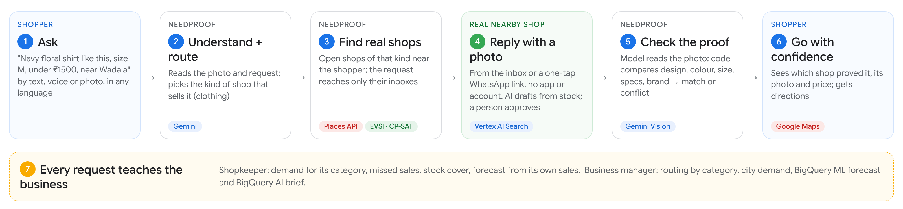
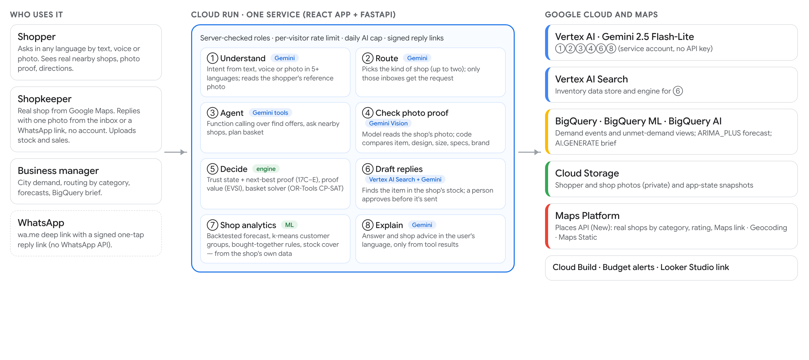

# NeedProof

### Know it's in stock before you go.

A shopper asks for an item in any language, by text, voice or photo. NeedProof sends the request to **real nearby shops of the right kind**, a shop proves it has the item with **one photo**, and **Gemini checks the proof** before the shopper travels. Every request also becomes demand data for the shop and the business.

Built on Google Cloud for the **Google AI Builder Cup 2026** (Retail & Commerce).

| | |
|---|---|
| **Live app** (Cloud Run, Singapore) | https://needproof-822406860102.asia-southeast1.run.app |
| **Demo video** | https://www.youtube.com/watch?v=H9QkBXVM89k |
| **Pitch deck** | [`docs/submission/NeedProof_AI_Builder_Cup.pdf`](docs/submission/NeedProof_AI_Builder_Cup.pdf) |
| **Architecture** | [`docs/submission/architecture.png`](docs/submission/architecture.png) |

---

## The problem

A shopper needs one specific thing today: a 65W laptop charger, a shirt in this exact print, a 750W mixer grinder. Online listings and maps say a shop *sells* something, not that the exact item is on its shelf right now. So people phone around or travel and find it missing, and the shop never learns it lost a sale. Most neighbourhood shops have no online catalogue at all.

## What NeedProof does



1. **Ask.** The shopper types, speaks or shows a photo: *"Navy shirt like this, size M, under ₹1500, near Wadala."*
2. **Understand and route.** Gemini reads the photo and the request and picks the kind of shop that sells it (clothing, electronics, grocery…, up to two kinds). Only those shops get the request.
3. **Find real shops.** Open shops of that kind near the shopper come from the Google Places API, with rating, Google Maps link and directions.
4. **One-photo reply.** A shop answers from its inbox or a one-tap WhatsApp link: no app, no account. If the shop uploaded its stock, Vertex AI Search finds the item and Gemini drafts the reply for a person to approve.
5. **Check the proof.** Gemini reads the shop's photo; NeedProof's code compares design, colour, size, specs and brand with the request and returns *matches* or *conflicts*, with reasons.
6. **Go with confidence.** The shopper sees which shop proved it, its photo and price, and gets directions.
7. **Learn from every request.** Shops see their own demand, missed sales, stock cover and forecasts; managers see demand by category, BigQuery ML forecasts and a BigQuery AI brief.

---

## Try it in 3 minutes

Open the [live app](https://needproof-822406860102.asia-southeast1.run.app) and use the **Signed in as** menu at the top to switch role.

1. **Shopper** in **Mumbai**: tap **📷 Search by photo: this shirt design**, add `size M, under ₹1500, near Wadala`, press **Ask**. See what Gemini understood and the real clothing shops it found.
2. On a shop in the list, click **Reply as shop ↗**. You are now that shopkeeper: pick the **Navy floral shirt** sample, enter a price, **Send photo proof**. Gemini returns *Photo matches the request*.
3. Do the same on a second shop with the **Red check shirt** sample. Gemini returns *Photo conflicts with the request*: wrong colour and pattern.
4. Back in the shopper window, both replies arrived live, with photos, prices and **Get directions**.
5. **Shopkeeper → My shop**: requests for this kind of shop, what was answered, missed sales. **My analytics**: upload a sales file to unlock forecast, customer groups and bought-together rules.
6. **Business manager**: requests routed by category, BigQuery ML demand forecast, **Write brief with BigQuery AI**.
7. **Admin / jury → Trust report**: how an answer is made, live model test results and safeguards.

> **Please use "Reply as shop"**, not the green **WhatsApp** button: WhatsApp opens a chat with the real business.
> Shops marked **Sample shop** are fictional and carry sample listings; every other shop is a real business from Google Places.

---

## Features

| Who | What they get |
|---|---|
| **Shopper** | Ask in any language by text, voice or photo · photo search ("find this design") · real nearby shops with rating, Maps link and directions · live replies with the shop's photo and Gemini's verdict · several items at once (basket planner) · remembers budget, device and past needs, with **Forget me** |
| **Shopkeeper** | Inbox of requests for its kind of shop, with the shopper's photo · one-photo reply, also from a signed WhatsApp link with no account · stock upload (Excel/CSV + photos) with AI-drafted replies that a person approves · **My shop**: demand, answered, missed sales · **My analytics** from its own sales file: forecast, customer groups, bought-together, stock cover |
| **Business manager** | Requests routed by shop category · city demand and missed demand · BigQuery ML forecast · BigQuery AI brief · every shop's analytics |
| **Admin / jury** | Every screen · Trust report with live tests, safeguards and benchmarks · reset data |

Roles are chosen from a menu for the demo, and the server checks role and shop on every private action.

---

## Where AI is used

| Step | AI | Google service |
|---|---|---|
| Read the shopper's reference photo | Gemini multimodal | Vertex AI |
| Understand the request (item, colour, size, budget, place, language) | Gemini with a typed schema | Vertex AI |
| Pick the kind of shop (up to two) for routing | Gemini | Vertex AI |
| Run the conversation and call tools (find offers, ask nearby shops, plan basket) | Gemini function calling | Vertex AI |
| Read each shop's reply photo (item, design, size, specs, brand, price) | Gemini multimodal | Vertex AI |
| Find the item in a shop's stock and draft its reply | Retrieval + Gemini; a person approves | Vertex AI Search + Vertex AI |
| Write the answer and the shop's weekly advice in the user's language | Gemini, from tool results only | Vertex AI |
| Forecast demand and write a demand brief | ARIMA_PLUS; `AI.GENERATE` | BigQuery ML, BigQuery AI |
| Shop analytics | Backtested forecasting (4 baselines), k-means customer groups, association rules | runs in the app |
| Which shops are worth asking; cheapest multi-item basket | Expected value of sample information (EVSI); OR-Tools CP-SAT | runs in the app |

**Design rule: Gemini understands and reads; code decides.** The match/conflict verdict, trust state and next-best proof come from deterministic rules and the decision engine, not from the model's opinion.

## Google Cloud services

| Service | How it is used |
|---|---|
| **Gemini 2.5 Flash-Lite on Vertex AI** | All model calls above, through a service account (no API key in production) |
| **Vertex AI Search** | Data store and engine over shops' uploaded stock |
| **BigQuery** | `needproof_loop` dataset: demand events, unmet-demand and daily-demand views |
| **BigQuery ML** | `ARIMA_PLUS` forecast of requests per product with a 90% interval |
| **BigQuery AI** | `AI.GENERATE` writes the manager's brief inside BigQuery |
| **Cloud Run** | One service (`needproof`, asia-southeast1) serving the React app and the FastAPI API |
| **Cloud Build / Artifact Registry** | Builds and stores the container on every `gcloud run deploy --source .` |
| **Cloud Storage** | Shopper and shop photos (private, served through the API) and app-state snapshots so redeploys keep data |
| **Google Maps Platform** | Places API (New) for real shops by category · Geocoding · Maps Static for the shop map |
| **Looker Studio** | Report link prepared on the BigQuery views |

Not used: Firebase, Firestore, AlloyDB, Cloud SQL.

---

## Architecture



- **Frontend:** React 19, Vite, Tailwind, Google Sans (`frontend/src/loop/`).
- **Backend:** Python, FastAPI, google-genai SDK, Pydantic schemas for every model output (`backend/app/commerce_loop/`).
- **Data:** SQLite inside the Cloud Run instance, restored from and snapshotted to Cloud Storage; BigQuery for analytics.
- **Live updates:** server-sent events per city, so a shop's reply appears on the shopper's screen without refreshing.
- **Safety:** server-checked roles, signed one-request reply links, per-visitor rate limit, daily AI-call cap, budget alert.

Key modules in `backend/app/commerce_loop/`:

| File | Responsibility |
|---|---|
| `agent.py` | Shopper agent: intent, routing, tool calls, requests to shops |
| `intent.py`, `snap.py` | Request understanding and reference-photo reading |
| `vision.py` | Reading a shop's photo and checking it against the request |
| `categories.py`, `discovery.py` | Shop categories, Google Places search, geocoding |
| `inventory.py`, `vertex_search.py` | Stock upload, Vertex AI Search, reply drafts |
| `myshop.py`, `analytics.py`, `sales_upload.py` | Shop dashboard and analytics from real data |
| `bigquery_loop.py` | BigQuery sync, BigQuery ML forecast, BigQuery AI brief |
| `engine.py`, `proof_plan.py`, `basket.py` | Decision engine, EVSI proof planner, OR-Tools basket |
| `access.py`, `replylink.py`, `guard.py`, `persist.py` | Roles, signed links, rate limits, state persistence |

---

## Evidence

| | Result |
|---|---|
| Live model tests on Vertex AI (Gemini 2.5 Flash-Lite) | **19 / 19**: 10 requests in 5 languages incl. a prompt-injection attempt, 5 shop photos, 4 reply drafts. Median 2.7 s to understand a request, 3.4 s to check a photo. Also 19 / 19 on AI Studio. |
| End-to-end photo search on Cloud Run | 7–9 s in our runs (photo read, intent, routing, Places search, agent answer); slower when Vertex AI is slow, with an 18 s timeout and one retry |
| Automated tests | 546 backend tests pass (`pytest`); lint and production build in CI; Playwright runs against the live site |
| Proof planner benchmark (500 seeded trials) | Asking only when worth it: net value ₹175 per decision vs ₹158 verifying every shop and ₹139 never verifying |
| Basket benchmark (30 seeded scenarios) | OR-Tools found all 14 feasible baskets; cheapest-item-first missed 3, single shop missed 5 |

Benchmarks are seeded simulations of the decision policy, not field results. All numbers are reproducible from this repo and shown live in the Trust report.

## Known limits

- Three **sample shops** per city are fictional and labelled; their listings and sales history are generated to show the analytics. Real shops show only real data.
- Model tests are small (19 hand-written cases, drawn sample photos). A field pilot with real shop photos is the next step.
- Google's own shop categories are sometimes wrong (for example a salon listed as a grocery).
- A photo is checked against the request, not for freshness; in-app camera capture and a shop trust score are planned.
- One Cloud Run instance with SQLite; Cloud SQL and Firebase Authentication are planned.

---

## Run locally

**Prerequisites:** Git, Python 3.12, Node.js 22+. A Gemini API key from Google AI Studio is enough for the AI features; without one the app runs in mock mode.

```bash
git clone https://github.com/shrinivashunnur08/NeedProof-AI.git
cd NeedProof-AI
```

**Backend** (terminal 1):

```bash
cd backend
python -m venv .venv
# Windows: .venv\Scripts\activate      macOS/Linux: source .venv/bin/activate
pip install -r requirements.txt
cp .env.example .env                   # Windows: copy .env.example .env
# edit .env: set GEMINI_API_KEY=<your key> and keep GEMINI_BACKEND=ai_studio
alembic upgrade head
uvicorn app.main:app --reload --port 8000
```

**Frontend** (terminal 2):

```bash
cd frontend
npm ci
npm run dev
```

Open http://localhost:5173. Vite forwards `/api` to the backend on port 8000. API docs: http://127.0.0.1:8000/docs.

Useful settings in `backend/.env` (see `.env.example` for all):

| Variable | Meaning |
|---|---|
| `GEMINI_BACKEND` | `ai_studio` (API key), `vertex` (service account) or `mock` |
| `LOOP_GEMINI_MODEL` | e.g. `gemini-flash-lite-latest` (AI Studio) or `gemini-2.5-flash-lite` (Vertex AI) |
| `DISCOVERY` + `MAPS_API_KEY` | `places` with a Places + Geocoding key for Google Places shops; default `osm` uses OpenStreetMap |
| `ANALYTICS_BACKEND` | `local` or `bigquery` |
| `LOOP_ENFORCE_ROLES` | `true` to check roles on the server |

Never commit `.env` or keys; `.env` is git-ignored.

### Tests

```bash
cd backend && python -m pytest -q tests/test_commerce_loop.py      # NeedProof app tests
cd frontend && npx eslint src/loop src/App.tsx && npm run build
```

CI (`.github/workflows/ci.yml`) runs the backend suite, lint and build on every push.

## Deploy to Google Cloud

```bash
gcloud auth login
gcloud config set project <your-project-id>
gcloud run deploy needproof --source . --region asia-southeast1
```

Cloud Build builds the `Dockerfile` (React build + FastAPI runtime) and Cloud Run serves it. APIs to enable, service-account roles, environment variables, BigQuery and Vertex AI Search setup, costs and teardown are in [`docs/GOOGLE_CLOUD.md`](docs/GOOGLE_CLOUD.md).

---

## Repository layout

```
backend/app/commerce_loop/   NeedProof backend (agent, vision, routing, analytics, Google integrations)
backend/tests/               pytest suite (test_commerce_loop.py covers the app end to end)
frontend/src/loop/           NeedProof React app
frontend/public/samples/     sample photos used by the demo buttons
infra/bigquery/              BigQuery table, ARIMA_PLUS model and AI.GENERATE SQL
docs/                        Google Cloud setup, evaluation reports, submission kit and deck
```

Other folders under `backend/app/` and `frontend/src/components/` hold the earlier NeedProof engines (decision engine, evidence passport, forecasting, segments) that the app reuses, plus earlier prototype screens.

## Roadmap

- **Pilot:** 20–30 real shops in one Mumbai neighbourhood; measure reply rate, time to proof and trips saved.
- **Trust:** in-app camera capture with timestamp, stock-image and screenshot detection, shop trust score.
- **Product:** replies inside WhatsApp (WhatsApp Business API), restock alerts, recommendations from past needs.
- **Platform:** Cloud SQL, more Cloud Run instances, Firebase Authentication, Looker dashboards.

## Team

| Name | Role | Contact |
|---|---|---|
| **Vishnuraj Yadav** | Team leader | yadavvishnuraj@gmail.com |
| **Shrinivas Hunnur** | Team member | yashhunnur7@gmail.com |
